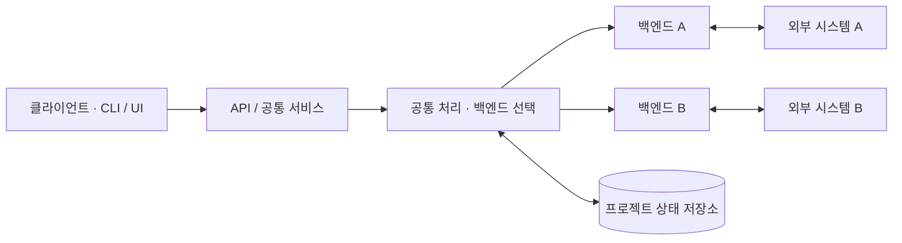

<!-- 작성 기준: https://github.com/ersione/project-guidelines/blob/main/guidelines/readme.md -->
<!-- 사용 전 {중괄호} 항목과 예시 구조를 실제 내용으로 바꾸고, 필요 없는 섹션과 안내 주석을 삭제하세요. -->

# {프로젝트 이름}

{누가 무엇을 할 수 있는 프로젝트인지 설명하는 한 문장}

<!-- 실제 로고가 있으면 추가합니다. 배지는 검증 가능한 핵심 정보만 넣습니다. -->
<!-- 공개 서비스·데모·문서·번역 README 링크는 실제로 존재하는 것만 추가합니다. -->

[주요 기능](#주요-기능) · [아키텍처](#아키텍처) · [설치](#설치) · [사용법](#사용법)

<!-- 도움이 되면 개인정보가 없는 실제 화면·데모를 추가합니다. CLI는 명령·출력 예시로 대신할 수 있습니다. -->

## 주요 기능

- {사용자가 얻는 핵심 결과 1}
- {사용자가 얻는 핵심 결과 2}
- {사용자가 얻는 핵심 결과 3}

## 아키텍처

<!-- 실행 방식·구성요소 선택에 도움이 되면 이 위치에 둡니다. 내부 구현 이해가 주목적이면 사용법 뒤로 옮깁니다. 단순한 프로젝트는 생략 가능합니다. -->

{클라이언트·공통 서비스·백엔드·외부 시스템의 관계를 설명하는 짧은 문단}

<!-- 아래는 교체용 예시입니다. 프로젝트가 실제로 갖춘 구성요소와 흐름으로 수정하세요. -->



| 구성요소 | 역할 |
|---|---|
| {구성요소} | {이 구성요소가 담당하는 일} |
| {저장소} | {어떤 데이터가 저장되고 누가 관리하는지} |

{주요 요청·이벤트 흐름과 선택·폴백·데이터 소유권 등 알아야 할 경계}

## 요구사항

- {지원 OS·런타임과 실제 최소 버전}
- {필수 도구·패키지 관리자}
- {필수 계정·권한·외부 서비스가 있을 때 그 역할}

## 설치

{소스 설치가 필요한지, 배포된 서비스에 바로 접속할 수 있는지 설명}

```sh
# 실제 저장소·패키지를 내려받는 명령
# 실제 의존성 설치 명령
# 최초 실행에 필요한 준비 명령
```

{첫 실행 성공 여부를 확인하는 방법과 필요한 설정 안내}

## 사용법

<!-- 설치·서버 실행과 별개로 실제 사용자가 수행하는 작업을 설명합니다. -->

### {핵심 작업}

{CLI 명령, 라이브러리 최소 코드 또는 UI 조작 순서와 기대 결과}

```text
실제 명령 또는 예상 출력으로 교체
```

### {다음 주요 작업}

{다음 작업과 중요한 입력·결과·실패 처리}

## 설정

<!-- 필요한 경우만 남깁니다. 실제 비밀값·운영 전용 주소·개인 경로를 넣지 않습니다. -->

| 변수·설정 | 역할 | 필수 여부·기본값 |
|---|---|---|
| `{설정 이름}` | {설정이 제어하는 동작} | {필수 여부와 공개 가능한 기본값} |

## 지원 범위와 제한 사항

{지원·미지원·미확인 범위를 구분하고 사용에 필요한 제약을 설명}

## 개발과 검증

```sh
# 실제 개발 실행 명령
# 실제 테스트·빌드·검사 명령
```

{검증이 보장하는 범위와 필요한 개발 환경}

<!-- 배포·기여·라이선스·참고는 실제 제공하는 내용이 있을 때만 추가합니다. -->
<!-- 라이선스 파일이 없으면 라이선스 배지·가짜 파일 링크를 만들지 않습니다. -->
